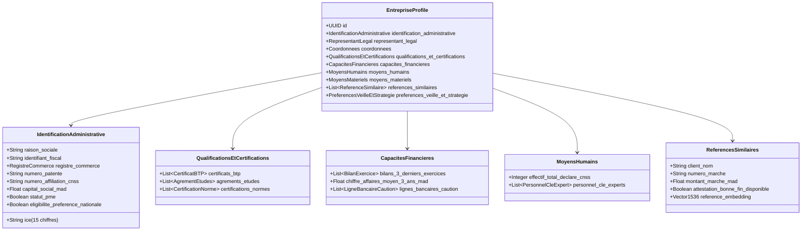

# Documentation T02 : Schéma du Profil Entreprise

**Projet :** Plateforme IA de réponse aux marchés publics marocains  
**Responsable :** P1 (Chef de projet, ML prédictif et évaluation)  
**Destinataires :** P6 (Socle & DB), P5 (Veille), P3 (Mémoire technique), P4 (Chiffrage & Conformité)  
**Cadre Réglementaire :** Décret n° 2-22-431 relatif aux marchés publics marocains

---

## 1. Objectif du Schéma

Le profil entreprise constitue la **clé de voûte de toute la chaîne de valeur** de la plateforme :
1. **Veille & Ciblage (Module A - P5) :** Détecter et scorer la pertinence des avis de marchés publiés en fonction des qualifications, domaines et régions de l'entreprise (seuil cible $\ge 70\%$).
2. **Score Go / No-Go (Module B2 - P6) :** Comparer automatiquement les exigences du DCE extrait (chiffre d'affaires requis, caution provisoire exigée, qualifications BTP ou agréments, références nécessaires) aux capacités réelles du candidat.
3. **Rédaction du Mémoire Technique (Module C - P3) :** Alimenter le moteur RAG avec le vivier d'experts (CVs certifiés), le parc matériel et les références similaires avec attestations de bonne fin, en garantissant un taux d'hallucination nul.
4. **Conformité & Chiffrage (Modules D & E - P4) :** Valider la disponibilité de la ligne de cautionnement bancaire, vérifier les dates de validité des pièces (attestation fiscale, CNSS), et ajuster le modèle de marge selon les seuils du Décret 2-22-431.
5. **Prédiction du Win-Rate (Module F - P1) :** Injecter le vecteur de caractéristiques de l'entreprise (taille, antériorité, ratios financiers, taux de réussite passé) dans le modèle de Gradient Boosting (XGBoost/LightGBM).

---

## 2. Structure et Composants du Profil

Le schéma est structuré en **8 blocs fonctionnels** :

---

## 3. Conformité aux Exigences Marocaines

| Champ | Référence Décret 2-22-431 / Droit marocain | Rôle dans l'application |
| :--- | :--- | :--- |
| **ICE (15 chiffres)** | Dahir n° 1-11-03 / Loi 09-08 | Identifiant unique national obligatoire sur tout acte d'engagement |
| **Statut PME** | Article 148 (Réservation de 20% des marchés aux PME) | Déclenche l'éligibilité aux marchés allotis ou réservés |
| **Préférence Nationale (15%)** | Article 147 (Majoration de 15% appliquée aux offres étrangères) | Paramètre clé de simulation financière (Module D) |
| **Certificats BTP & Agréments** | Système ministériel de qualification et classification | Filtrage bloquant dans le Go/No-Go (Module B2) |
| **Ligne de Caution Bancaire** | Article 22 (Caution provisoire et caution définitive) | Alerte de capacité de trésorerie avant soumission (Module E) |
| **Attestations de Bonne Fin** | Article 27 (Dossier technique du soumissionnaire) | Vérification d'admissibilité technique et preuve RAG |

---

## 4. Fichiers Livrés et Rôle pour les Coéquipiers

1. **`schemas/company_profile.schema.json`** :
   - Schéma standard JSON Schema Draft-07.
   - Utilisé par P6 pour la validation des payloads d'entrée dans FastAPI (`POST /companies`).
2. **`schemas/company_profile_model.py`** :
   - Classes Pydantic V2 avec validateurs regex (ICE, CIN, téléphone marocain, dates).
   - Intégrable directement dans le backend FastAPI et Celery.
3. **`schemas/company_profile.sql`** :
   - DDL PostgreSQL 16 intégrant l'extension `vector` (pgvector).
   - Table `company_personnel` et `company_references` dotées de colonnes vectorielles `vector(1536)` pour la recherche sémantique RAG (P3) et le matching d'opportunités (P5).
4. **`data/mock_company_profile.json`** :
   - Profil complet d'une entreprise marocaine réelle modélisée (*ATLAS DIGITEC & INFRASTRUCTURE SARL*).
   - Permet à tous les coéquipiers de tester leurs modules sans attendre la saisie utilisateur.

