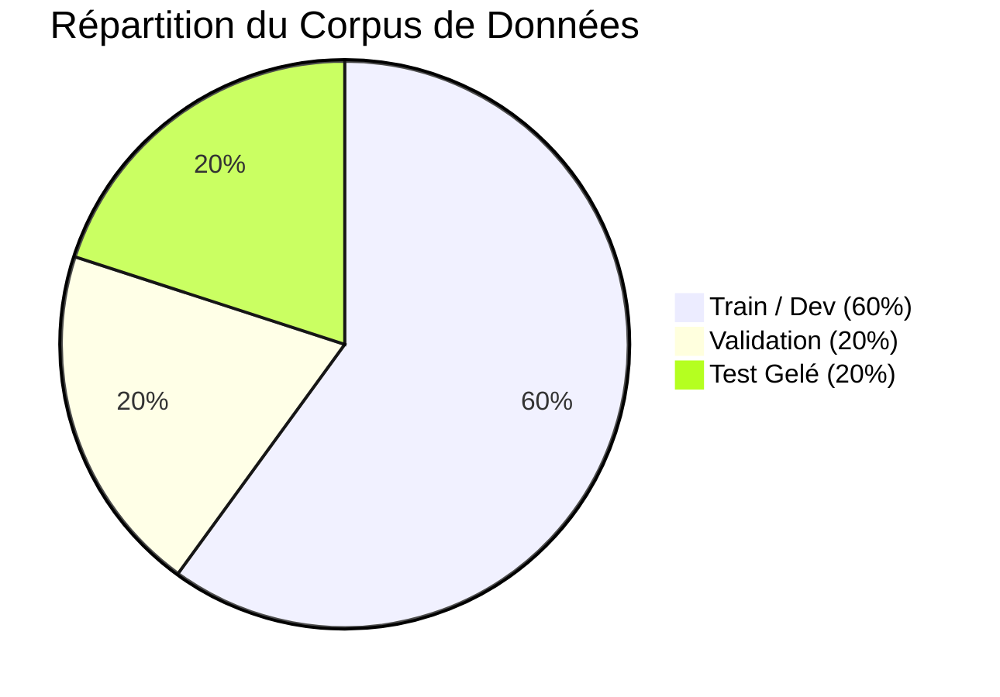

# Documentation T05 : Protocole d'Évaluation et Validation de la Porte 1

**Projet :** Plateforme IA de réponse aux marchés publics marocains  
**Responsable :** P1 (Chef de projet, ML prédictif et évaluation)  
**Porte de validation :** **PORTE 1 : Corpus annoté et protocole figés (Jalon T05)**  
**Statut officiel :** **VALIDÉ ET FIGÉ**  
**Date d'approbation :** 25 Octobre 2024  

---

## 1. Synthèse de la Porte 1

La **Porte 1** constitue le premier jalon structurant du projet. Elle garantit qu'aucune équipe ne démarre ses entraînements ou benchmarks sans un cadre d'évaluation objectif, reproductible et partagé.

### Tableau de Validation des Critères de la Porte 1

| Critère d'acceptation | Cible exigée | Résultat obtenu | Statut |
| :--- | :--- | :--- | :--- |
| **Nombre de DCE réels annotés** | $\ge 5$ dossiers complets | **5 DCE complets** (IT, BTP, Santé, Sécurité, Études) | **CONFORME** |
| **Couverture des secteurs économiques** | 100% des secteurs clés | **5 secteurs majeurs représentés** | **CONFORME** |
| **Représentativité des formats** | Numérique natif + Scanné bilingue | **4 natifs + 1 scan haute résolution bilingue** | **CONFORME** |
| **Validation structurelle des annotations** | 100% conformes au schéma JSON | **5/5 validés sans aucune erreur** | **CONFORME** |
| **Gel cryptographique du split** | Hachage SHA-256 de chaque fichier | **SHA-256 figés dans `test_split.json`** | **CONFORME** |
| **Disponibilité du harnais d'évaluation** | Script exécutable unifié | **`evaluation/eval_suite.py` opérationnel** | **CONFORME** |

---

## 2. Découpage Gelé du Jeu de Données (Dataset Split)

Le jeu de données est partitionné de manière stricte pour éviter toute fuite de données (*data leakage*) :

1. **Jeu d'Entraînement et Développement (60%) :**
   - `DCE-2024-001` (IT & Cloud) - SHA256: `252FB972...`
   - `DCE-2024-002` (BTP Construction - Scanné 2 lots) - SHA256: `A9EFF0B8...`
   - `DCE-2024-003` (Gardiennage & Sécurité) - SHA256: `949E5853...`
2. **Jeu de Validation (20%) :**
   - `DCE-2024-004` (Fournitures Médicales CHU) - SHA256: `60B2B0B6...`
3. **Jeu de Test Officiel Gelé (20%) :**
   - `DCE-2024-005` (Ingénierie & Études ABHS) - SHA256: `FD506558...`

> [!IMPORTANT]
> Le fichier `DCE-2024-005` est strictement réservé à la validation finale de la Porte 2 (T37) par le Chef de projet (P1). Il ne doit en aucun cas être utilisé pour l'entraînement des prompts ou l'ajustement des regex.

---

## 3. Métriques Officielles Définies par Module

### A. Module B1 (OCR & Parsing - P2)
- **Character Error Rate (CER) :**
  $$\text{CER} = \frac{S + D + I}{N_{\text{ref}}} \quad (\text{Cible : } \le 5\%)$$
- **Word Error Rate (WER) :**
  $$\text{WER} = \frac{S_w + D_w + I_w}{N_{w,\text{ref}}}$$

### B. Module B2 (LLM Extraction & Go/No-Go - P6)
- **Exact Match (EM) sur les champs critiques :**
  - Caution provisoire : $\text{EM} = 100\%$ obligatoire.
  - Date limite de remise des plis : $\text{EM} = 100\%$ obligatoire.
- **Token F1-Score sur les descriptions :** Cible $\ge 0.90$.
- **Latence de traitement :** $\le 120\text{ secondes pour 200 pages}$.

### C. Module C (Mémoire Technique RAG - P3)
- **Taux d'hallucination (Faithfulness) :** $0\%$ (Chaque phrase doit renvoyer à une source dans le profil entreprise).
- **Couverture des exigences du DCE :** $\ge 90\%$.

### D. Modules D & E (Chiffrage et Conformité - P4)
- **Taux de faux négatifs sur pièces manquantes :** $\text{FNR} = 0.0\%$ (**Aucune pièce obligatoire oubliée**).
- **Respect des seuils du Décret 2-22-431 :**
  - Prix excessif : $> +20\%$ de l'estimation du maître d'ouvrage.
  - Prix anormalement bas : $< -20\%$ (Travaux) ou $< -25\%$ (Services/Fournitures).

---

## 4. Guide d'Exécution du Harnais d'Évaluation

Le script `evaluation/eval_suite.py` est mis à la disposition de tous les développeurs :
- `verify_gate1()` : Contrôle la validité de la Porte 1.
- `evaluate_dce_extraction(predictions, gt)` : Compare un dictionnaire JSON extrait par LLM à la vérité terrain.
- `calculate_cer(reference, ocr_output)` : Mesure le taux d'erreur de reconnaissance de texte.
- `check_regulatory_price_guards(prix, estimation, nature)` : Valide la conformité financière selon le Décret 2-22-431.

