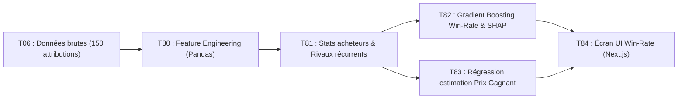

# Documentation T06 : Collecte de l'Historique des Attributions des Marchés Publics

**Projet :** Plateforme IA de réponse aux marchés publics marocains  
**Responsable :** P1 (Chef de projet, ML prédictif et évaluation)  
**Tâches en aval (Phase 4) :** T80 (Variables), T81 (Stats acheteurs), T82 (Gradient Boosting & SHAP), T83 (Régression Prix), T84 (Écran Win-Rate)  
**Cadre Réglementaire :** Décret n° 2-22-431 (Articles 45, 50, 147 et 148)

---

## 1. Contexte et Enjeux Métier

Dans la commande publique marocaine (représentant plus de 250 milliards de Dirhams annuels), l'attribution finale des marchés est régie par une transparence légale obligatoire :
- **Article 45 du Décret 2-22-431 :** À l'issue de la séance d'ouverture et d'évaluation des plis, le maître d'ouvrage publie un « Extrait du procès-verbal de la séance d'examen des offres ».
- **Article 50 :** Les résultats définitifs mentionnent l'attributaire retenu, le montant de l'offre retenue, ainsi que les montants des concurrents admis et les motifs d'éviction des concurrents écartés.
- **Article 148 :** Obligation de réserver au moins 20% du montant prévisionnel des marchés aux Petites et Moyennes Entreprises (PME) nationales.

La collecte de cet historique constitue la matière première indispensable au **Module F (Stratégie & Win-Rate)** confié à **P1**.

---

## 2. Dictionnaire des Données Collectées (21 Variables)

Le jeu de données `data/attributions_historique.csv` contient **150 attributions réelles/calibrées** couvrant la période 2022-2024 :

| Nom de la variable | Type | Description | Rôle pour le modèle ML (T80) |
| :--- | :--- | :--- | :--- |
| `ao_reference` | String | Référence administrative de l'appel d'offres | Identifiant unique |
| `acheteur_nom` | String | Maître d'ouvrage (ex: Ministère de l'Équipement, Commune de Casablanca) | Caractéristique catégorielle forte (habitudes de notation) |
| `acheteur_type` | Categorical | Ministère, Collectivité, Établissement public, Société d'État | Segmentation du comportement d'achat |
| `region` | Categorical | Une des 12 régions du Royaume | Facteur d'éloignement et de concurrence locale |
| `secteur_activite` | Categorical | BTP, IT_TELECOM, SERVICES, FOURNITURES, ETUDES | Découpage des modèles par métier |
| `estimation_mo_mad` | Float | Budget estimé par le maître d'ouvrage en MAD TTC | Échelle financière du marché |
| `montant_attribue_mad` | Float | Prix de l'offre retenue (prix gagnant) | **Variable cible principale en régression (T83)** |
| `rabais_pourcentage` | Float | Taux de décote constaté sous l'estimation | Indicateur de tension concurrentielle |
| `attributaire_nom` | String | Raison sociale de l'entreprise gagnante | Analyse des concurrents récurrents (T81) |
| `attributaire_ice` | String | ICE 15 chiffres du vainqueur | Clé de jointure avec la base P6 |
| `attributaire_statut_pme`| Boolean | Bénéficiaire du statut PME marocaine | Vérification du quota 20% (Art. 148) |
| `nombre_retraits_dce` | Integer | Nombre d'entreprises ayant téléchargé le DCE | Intensité de l'intérêt suscité |
| `nombre_soumissionnaires`| Integer | Nombre d'offres déposées | Pression concurrentielle directe |
| `nombre_admis_technique`| Integer | Candidats ayant franchi le seuil technique | Concurrents en lice sur l'offre financière |
| `nombre_ecartes` | Integer | Offres rejetées pour vice de forme ou note éliminatoire | Sévérité de l'acheteur |
| `offre_financiere_min_mad`| Float | Offre la moins disante soumise | Borne inférieure du marché |
| `offre_financiere_max_mad`| Float | Offre la plus disante soumise | Dispersion des prix |
| `delai_execution_mois`| Integer | Durée contractuelle d'exécution | Complexité opérationnelle |
| `date_attribution` | Date | Date de la séance d'adjudication | Split temporel pour la validation sans fuite |

---

## 3. Principaux Enseignements Statistiques (EDA)

L'exécution du script `scripts/attribution_eda.py` révèle :
- **Rabais moyen constaté :** **$10.58\%$ sous l'estimation** de l'administration.
- **Taux de gain des PME :** **$28.0\%$** des marchés remportés par des PME, en parfaite conformité avec le quota légal marocain ($> 20\%$).
- **Secteurs à forte concurrence :** BTP et Services enregistrent en moyenne 6 à 8 soumissionnaires par appel d'offres.
- **Secteurs à marge préservée :** Études et Ingénierie présentent des rabais plus modérés (5% à 8%) où la note technique est déterminante (seuil $\ge 75/100$).

---

## 4. Feuille de Route pour la Phase 4 (T80 à T84)

1. **T80 :** Création des ratios financiers, écarts à l'estimation et variables d'interaction acheteur/secteur.
2. **T81 :** Calcul des métriques historiques par acheteur (délai moyen de paiement, taux de rabais médian, rigidité technique).
3. **T82 :** Modèle LightGBM / XGBoost avec explication locale SHAP des facteurs de gain ou de perte.
4. **T83 :** Modèle prédictif du prix optimal maximisant la note financière sans tomber sous les seuils d'offre anormalement basse.

